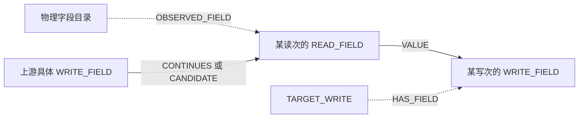
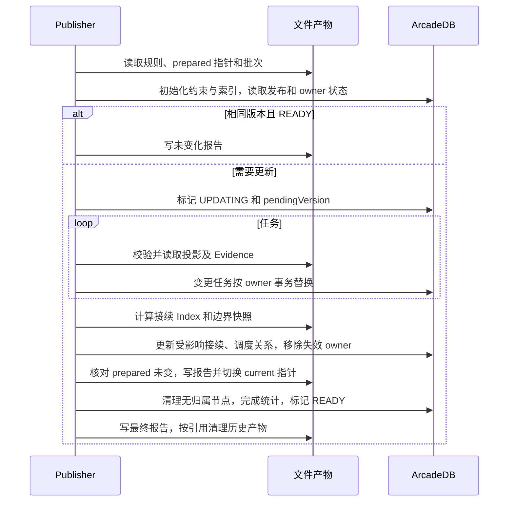

# SQL 血缘与图谱实现明细

本文面向需要阅读代码、接入输入或维护图谱的人。总体架构见 [TECHNICAL_DESIGN.md](TECHNICAL_DESIGN.md)，本文进一步解释文件如何组织、记录如何关联、图边如何生成、更新如何提交，以及查询返回值如何理解。

文档依据本仓库实现整理；示例中的任务、数据源、表和 SQL 均为虚构。JSON 片段只用于解释字段，不是可以直接导入的完整事实包。本文没有修改解析器、提升事实版本或执行真实数据库集成验收。

## 阅读导航

- [1. 模块及版本](#1-模块及版本)
- [2. 运行目录和产物](#2-运行目录和产物)
- [3. Input Pack 字段与写入](#3-input-pack-字段与写入)
- [4. 从 SQL 到事实](#4-从-sql-到事实)
- [5. Machine Facts 文件和关联键](#5-machine-facts-文件和关联键)
- [6. 当前事实读取校验](#6-当前事实读取校验)
- [7. 任务内投影与身份](#7-任务内投影与身份)
- [8. 从投影编译到存储图](#8-从投影编译到存储图)
- [9. 跨任务接续算法](#9-跨任务接续算法)
- [10. 缓存与发布过程](#10-缓存与发布过程)
- [11. ArcadeDB HTTP 传输](#11-arcadedb-http-传输)
- [12. 查询接口与返回语义](#12-查询接口与返回语义)
- [13. 前端消费与分区选择](#13-前端消费与分区选择)
- [14. 配置与运行](#14-配置与运行)
- [15. SQL 示例逐步解释](#15-sql-示例逐步解释)
- [16. 错误定位与验收](#16-错误定位与验收)
- [17. 代码阅读索引](#17-代码阅读索引)

## 1. 模块及版本

### 1.1 调用关系

| 模块                         | 接收什么                         | 负责什么                         | 不应由它决定什么                 |
| ---------------------------- | -------------------------------- | -------------------------------- | -------------------------------- |
| 平台采集 / 缓存导入          | 任务范围、SQL 与元数据接口或缓存 | 保存输入与采集依据               | 不提前把平台关联当作解析血缘     |
| Input Pack                   | 任务信息、SQL 槽位、表结构       | 输入格式、身份、文件哈希与持久化 | 不混入下游计算出的血缘结论       |
| Plan Adapter / Machine Facts | SQL、方言、Schema、上下文        | 结构化解析与事实加工             | 不以业务推测填补无法解析的字段   |
| Current Bundle Reader        | 当前索引和事实包                 | 确认版本、当前性和完整性         | 不扫描历史目录替当前索引做选择   |
| Task-local Projection        | 已读取事实和输入上下文           | 生成任务内关系、闭合摘要和 gap   | 不自行把另一个任务的字段接过来   |
| Asset Compiler / Publisher   | 明确批次、投影、证据与规则       | 编译图、跨任务接续、增量写入     | 不执行原业务加工任务             |
| 查询服务 / UI                | 已发布图及发布所引用的文件       | 检索、追踪、解释和展示           | 不在查询时悄悄重新生成事实或投影 |

### 1.2 不同版本号不能互相替代

| 对象                         | 当前代码中的值                 | 含义及位置                                                                                                     |
| ---------------------------- | ------------------------------ | -------------------------------------------------------------------------------------------------------------- |
| Input Pack Schema            | `1.0.0`                        | Task / Table Document 格式；[input-pack.ts](scripts/input/shared/input-pack.ts)                                |
| Machine Facts 生成契约       | `1.3.0`                        | 当前生成器写入 Manifest 的版本；[machine-facts-contract.ts](scripts/machine-facts/machine-facts-contract.ts)   |
| Machine Facts Adapter        | `1.3.20`                       | 事实生成适配器版本，与事实契约分开                                                                             |
| Reader 当前 L1 门槛          | `2.0.0`                        | Reader 将其归为 `CURRENT_L1`；`1.3.0` 归为遗留；[current-task-bundle.ts](scripts/query/current-task-bundle.ts) |
| Task-local Projection Schema | `1.3.0`                        | 图投影自己的结构版本；[contract.ts](scripts/project-graph/task-local/contract.ts)                              |
| Continuation Index Schema    | `1.0.0`                        | 跨任务接续索引格式；[continuation-index.ts](packages/data-graph/src/continuation/continuation-index.ts)        |
| Asset Compiler               | `1.0.18`                       | 图编译实现版本，参与发布版本计算；[publish.ts](packages/data-graph/src/asset-graph/publish.ts)                 |
| Continuation Match Policy    | `business-partitions-first-v3` | 生产者与业务分区的接续匹配规则版本                                                                             |

因此，看到投影 `schemaVersion: "1.3.0"` 不能据此判断它引用的是哪一版事实；看到接续候选 `evidenceLayer: "L1"` 也不能据此判断事实包已升级到 2.0.0。必须沿引用关系分别核对。当前生成端和当前 L1 门槛尚未对齐，文档保留这一实际状态。

## 2. 运行目录和产物

下面以示例配置解析后的 `.runtime` 为运行根目录。配置可改变位置；尖括号是占位符，不是实际目录名。

```text
.runtime/
  evidence/                             平台证据与缓存，结构由采集器决定
  input-packs/
    tasks/<taskCategory>/<taskId>/
      task.json                         任务描述与 SQL 文件索引
      sql/<slot>.sql                    采集到的 SQL
    tables/<platform>/<stableTableId>/
      table.json                        表身份与 DDL 文件索引
      ddl.sql                           表结构证据
  facts/
    indexes/task-fact-index.jsonl        当前事实索引
    registry/tasks/<taskId>/
      analysis-status.json              当前分析状态与请求哈希
      bundle/manifest.json              当前事实 Manifest
      bundle/*.jsonl                    语句、读写、表达式、绑定等
    snapshots/sql/                      按哈希保存的分析 SQL 快照
    snapshots/schema/                   按哈希保存的 Schema 快照
  projections/
    tasks/<taskId>/versions/
      <cacheKey>.json                    投影缓存 Envelope
      <cacheKey>.evidence-v4.json        发布与解释所用证据副本
  graphs/<batch>/
    batches/<preparedVersion>/batch-manifest.json
    prepared.json                       指向待发布批次
    prepare-progress.json               准备进度
    published/<publicationVersion>/     接续索引、边界快照、发布报告等
    current.json                        文件侧当前发布指针
```

路径树表示主要产物，不是必须手工创建的目录清单。事实 JSONL 的读取层也支持相应压缩存储；不能随意改文件名并绕过 Manifest 的哈希校验。

图数据库之外仍需要文件产物：字段加工解释读取发布批次引用的投影和 Evidence 文件，候选查询读取已发布 Index。只备份 ArcadeDB，不能保证解释接口还可用。发布会清理部分历史产物，长期归档需另外保存。

## 3. Input Pack 字段与写入

### 3.1 Task Document

来源：[输入契约与写入器](scripts/input/shared/input-pack.ts)。

| 字段或字段组                           | 内容                                                     | 处理约束                                         |
| -------------------------------------- | -------------------------------------------------------- | ------------------------------------------------ |
| `schemaVersion`                        | 输入包版本                                               | 当前 `1.0.0`                                     |
| `taskId`、`taskCategory`               | 任务身份和类型                                           | 决定任务包目录；路径片段需要校验                 |
| `taskName`、`topicName`                | 名称与专题背景                                           | 展示信息，不是物理表身份                         |
| `sqlFiles[]`                           | 每份 SQL 的 `slot`、`path`、`sha256`、`evidenceProvider` | 槽位唯一，文件路径需符合约定，内容哈希需一致     |
| `source`、`target`                     | 平台记录的端点                                           | 必须结合证据种类及数据源身份使用                 |
| `targetEvidenceKind`                   | 如 `DIRECT_PLATFORM_TARGET`、`SQL_EXACT_TABLE_TARGET`    | 表示目标是如何得到的，不同证据不能混同           |
| `upstreamTaskIds`、`downstreamTaskIds` | 直接调度邻居                                             | 缺字段与已证明的空列表含义不同；仅作为调度背景   |
| `partition`、`schedulerEvidence`       | 已知分区及调度配置依据                                   | 脚本参数不是已经求值的运行分区                   |
| `codeEvidence`                         | 原始脚本定位、参数、仓库版本及采集状态等                 | 配置证据不等于运行实例证据                       |
| `writeColumnEvidence`                  | 显式写入列映射依据                                       | 再采集时保留旧映射及其哈希；输入变化后应重新验证 |
| `collectedAt`、`contentHash`           | 采集时间和任务内容版本                                   | 计算内容哈希时排除时间与哈希字段本身             |

SQL 槽位枚举为 `create`、`query`、`prepare`、`truncate`、`finish`。这是输入分类，不能把枚举排列当成实际调度执行顺序。某个槽位缺失也不能直接解释为“任务从未执行这一步”。

SQL 文件索引节选：

```json
{
  "slot": "query",
  "path": "sql/query.sql",
  "sha256": "<由实际 SQL 内容计算的 SHA-256>",
  "evidenceProvider": "example:metadata-export"
}
```

Task / Table 输入校验禁止 `lineage`、`fieldLineage`、`processingRelation` 等派生结论字段混进输入层，避免把下游推断循环当成上游原始证据。

### 3.2 Table Document

| 字段                                      | 内容                                            | 作用                                                                           |
| ----------------------------------------- | ----------------------------------------------- | ------------------------------------------------------------------------------ |
| `schemaVersion`                           | 输入包版本                                      | 与 Task Document 同属输入层                                                    |
| `stableTableId`                           | 表包定位标识                                    | 由 qualifiedName 与 dataSource 构成目录标识；GUID 可另行保留，不替代此目录标识 |
| `platform`、`dataSource`、`qualifiedName` | 物理对象身份                                    | 区分不同平台、数据源的同名表                                                   |
| `objectType`                              | 表、视图等对象类别                              | 不应默认每个对象都是可写物理表                                                 |
| `ddlFile`                                 | `path: "ddl.sql"`、`sha256`、`evidenceProvider` | 将对象描述绑定到结构证据                                                       |
| `description`、主键与分区等可选信息       | 平台直接提供的元数据                            | 描述用于展示，结构字段参与解析上下文                                           |
| `collectedAt`、`contentHash`              | 时间和内容版本                                  | 内容变化驱动后续重算                                                           |

### 3.3 一次写入如何完成

写入器先生成文档并校验，在临时目录写 SQL / DDL 和描述文件，再核对文件哈希，通过后替换目标目录。相同 `contentHash` 可返回未变化，避免仅因重采集时间不同触发重算。替换过程包含备份与失败恢复，但不能将它描述成跨所有任务输入的总事务。

在线采集与缓存导入共用输入格式。缺 SQL、缺 DDL、端点身份不完整时，应先使用相应补采或修复脚本；不应手工往输入包塞一条猜测的血缘边。

## 4. 从 SQL 到事实

### 4.1 处理步骤

1. 读取任务包及各 SQL 槽位，检查引用文件和结构材料。
2. 根据任务上下文选择方言，建立 Schema 和物理对象目录。
3. 生成用于分析的标准化 SQL，保存其与原始输入的来源、哈希关系。
4. 通过 SQLLens 获取静态解析结果，Plan Adapter 组织关系、表达式、来源和输出信息。
5. 识别语句读写和具体写观察，结合显式目标列、建表信息或目标 Schema 建立输出绑定。
6. 对任务内先写后读生成临时物化桥接；不明确的绑定、字段或读次保留 unknown / gap。
7. 写事实文件、Manifest、分析状态和当前索引，供消费者按完整性规则读取。

代码入口：[input-pack-machine-facts.ts](scripts/machine-facts/input-pack-machine-facts.ts)、[plan-adapter.ts](scripts/plans/plan-adapter.ts)、[machine-facts.ts](scripts/machine-facts/machine-facts.ts)。

### 4.2 原始 SQL 与分析 SQL

采集文本可能包含重复脚本片段、多个槽位或需要上下文才能解释的 SQL。规范化仅服务于静态解析，不能覆盖原始证据、改写业务公式后仍称为原文。

事实中的 `span` / `source_span` 是对应文本中的位置。Reader 对语句使用 `sqlText.slice(start, end)` 回核原文，因此区间是起点包含、终点不包含的字符串偏移，不能当成文件字节偏移或页面行号。

解释接口展示原 SQL 行号时，会在冻结的槽位文本中寻找可唯一定位的语句和片段。不能确认唯一位置时，不应把分析 SQL 的偏移硬套回原始槽位文本。

### 4.3 输出绑定的关键规则

输出字段需要同时绑定到 `write_observation_id`、目标表、目标字段及表达式，不能只有“字段 A 来自字段 B”。

| `binding_method`              | 依据               | 需要关注                                    |
| ----------------------------- | ------------------ | ------------------------------------------- |
| `EXPLICIT_TARGET_COLUMN_LIST` | SQL 显式目标列清单 | 列位置和对应查询输出是否一致                |
| `SQL_CREATE_POSITIONAL`       | SQL 建表输出位置   | 建表与查询生产者是否正确配对                |
| `TARGET_SCHEMA_POSITIONAL`    | 目标结构中的位置   | Schema 是否匹配，是否存在额外目标列或缺结构 |

`source_ordinal` 和 `target_ordinal` 分别记录两侧位置，应按生成器具体绑定逻辑使用，不能跨语句或 SQL 槽位只凭相同序号配对。`binding_status: "RESOLVED"` 表示这条绑定成功，不代表同一任务所有输出都成功。

## 5. Machine Facts 文件和关联键

### 5.1 事实文件目录

下表对应当前写入器；文件存在、记录非空、语义完整是三个不同判断。

| 文件                                  | 主要记录                                                    | 用来回答什么                                                            |
| ------------------------------------- | ----------------------------------------------------------- | ----------------------------------------------------------------------- |
| `statements.jsonl`                    | `statement_id`、任务、语句序号、类型、原文、区间、解析状态  | 这条事实属于哪一条 SQL                                                  |
| `schema-refs.jsonl`                   | `schema_ref_id`、限定名、结构状态、DDL 哈希、物理列及分区列 | 解析使用了哪份结构证据                                                  |
| `dataset-io.jsonl`                    | 读写方向、数据集、解析状态、写观察、分区、读次等            | 任务在哪个上下文读写了什么                                              |
| `relation-nodes.jsonl`                | `relation_id`、关系类型、语句、关系内容和区间               | 加工关系有哪些步骤                                                      |
| `relation-edges.jsonl`                | 关系端点、边类型和证据                                      | 加工步骤如何连接                                                        |
| `field-expression-nodes.jsonl`        | `expression_id`、表达式、输入字段、角色、区间、依赖状态     | 字段由什么表达式和输入构成                                              |
| `column-lineage-edges.jsonl`          | 字段到表达式的引用、方法与解析来源                          | 哪些字段参与了某个表达式                                                |
| `output-field-bindings.jsonl`         | `binding_id`、写观察、表达式、目标字段与两侧位置            | 哪个表达式写入哪个目标字段                                              |
| `task-local-materializations.jsonl`   | `bridge_id`、任务内写观察、后续读、绑定、状态与证据         | 任务内部先写后读如何衔接                                                |
| `unknowns.jsonl`                      | 结果类别、原因码、说明与对象定位                            | 哪些内容不能得出结论                                                    |
| `lineage-hop-roots/nodes/edges.jsonl` | Hop 相关结构的文件位置                                      | 当前写入器在这三类文件中写空记录集，不能据文件存在宣称中间 Hop 链已生成 |

`field-expression-nodes.jsonl` 中的 `input_dependency_status` 包括 `PHYSICAL`、`DERIVED_OUTPUT`、`SQL_CANDIDATE`、`PARTIAL`、`UNRESOLVED`、`NO_PHYSICAL_INPUT`。常量表达式可以没有物理输入；无法解析的输入不能同样标成“没有来源”。

表达式角色还能区分 CASE / IF 的分支选择和值贡献，以及窗口函数的 `VALUE`、`WINDOW_PARTITION`、`WINDOW_ORDER`。窗口排序列、分区列和最终返回的值来源需要分别说明。

### 5.2 一条输出的关联链

```text
statement_id
  ├─ dataset-io.write_observation_id             具体写次
  ├─ relation-nodes.relation_id                  加工关系
  └─ field-expression-nodes.expression_id        输出表达式
       ├─ column-lineage-edges                   物理输入或中间依赖
       └─ output-field-bindings.binding_id
            ├─ write_observation_id              必须对齐同一次写
            ├─ target_dataset / target_field
            └─ source_ordinal / target_ordinal
```

同一目标表、同一目标字段被写两次时，必须保留两组写观察与绑定。只按 `target_dataset + target_field` 去重会丢失覆盖、分支或追加写入的差异。

### 5.3 Manifest 与分析状态

| 对象                | 关键字段                                                                          | 用途                                       |
| ------------------- | --------------------------------------------------------------------------------- | ------------------------------------------ |
| Manifest 身份       | `schema_version`、`task_id`、`logical_source_id`、`status`                        | 明确契约、任务及分析来源                   |
| Manifest 输入       | SQL / Schema 哈希及快照路径、`analysis_config_sha256`、Input Pack 来源            | 识别事实基于哪一版输入                     |
| Manifest 方法       | 方言、parser、writer adapter、plan adapter 版本                                   | 识别用哪套实现生成                         |
| Manifest 输出       | 每个文件的 `path`、`schema_version`、`row_count`、`content_sha256`                | 校验文件完整性与记录规模                   |
| Manifest 统计与门禁 | `counts`、`gates`                                                                 | 保留检测结果；不能跳过具体门禁只看 SUCCESS |
| Manifest 边界       | 业务正确性、运行执行均未评价；不读取业务行；不在本层做跨任务字段拼接              | 明确静态事实的证明范围                     |
| Analysis Status     | `ANALYZING / SUCCESS / FAILED`、请求输入哈希、`current_manifest_sha256`、失败原因 | 防止把旧的成功文件当成当前成功结果         |

未知结果类别包括 `UNKNOWN`、`NOT_EVALUABLE`、`NOT_APPLICABLE`、`FAILURE`。缺少结构导致无法评价，应与确实不适用区分。

## 6. 当前事实读取校验

[Current Bundle Reader](scripts/query/current-task-bundle.ts) 的消费链为：

```text
Current Index → 任务分析状态 → Manifest → 输入快照与输出文件 → 引用和区间
```

主要校验包括：任务 ID 和相对路径安全；索引可读且任务有记录；状态与 Manifest 一致；请求的 SQL、Schema、配置哈希与 Manifest 相符；契约在可识别集合中；所需输出存在且哈希匹配；语句和表达式等引用与文本区间有效。具体分支以 Reader 为准，不能把这张概括表当成替代校验器。

| 读取结果        | 后续含义                                                           |
| --------------- | ------------------------------------------------------------------ |
| `CURRENT_L1`    | 2.0.0 事实通过当前读取校验，投影证据可标 `CONFIRMED`               |
| `LEGACY_NOT_L1` | 可消费的遗留契约，投影证据标 `PROVISIONAL_LEGACY`                  |
| `STALE`         | 当前索引或输入状态不能对应，例如 `TASK_NOT_INDEXED` 或输入哈希变化 |
| `INVALID`       | 缺失、格式、哈希、引用等完整性问题，需定位具体 `issues`            |

2.0.0 读取门槛包含 `capability-summary.json` 等必需文件。当前 1.3.0 写入器不能靠修改 Manifest 字符串就满足这些要求，且契约升级还涉及字段与语义的完整校验。

## 7. 任务内投影与身份

### 7.1 投影对象

| 字段                                                         | 内容                                    |
| ------------------------------------------------------------ | --------------------------------------- |
| `schemaVersion`、`artifactType`                              | 投影格式及 `TASK_LOCAL_PROJECTION` 类型 |
| `taskId`、`taskCategory`                                     | 任务身份和类型                          |
| `generatedAt`、`contentHash`                                 | 生成时间和内容标识                      |
| `coverageStatus`、`coverageDisposition`、`failureReasonCode` | 覆盖结果、覆盖性质与失败原因            |
| `nodes[]`                                                    | `nodeId`、`nodeType`、`properties`      |
| `edges[]`                                                    | `edgeId`、`edgeType`、两个端点及属性    |
| `localClosure`                                               | 最终写、外部读和任务内字段路径摘要      |
| `gaps[]`                                                     | `gapId`、`reasonCode`、`details`        |

`localClosure.finalWrites` 保留写观察、目标写节点、数据集身份及输出资格；`externalReads` 保留读次、读次节点、数据集身份及身份状态；`localFieldPaths` 记录来源字段、目标写、输出列和临时物化桥接。这些摘要用于后续编译和接续，不是“所有来源均已闭合”的总证明。

### 7.2 节点、边和稳定 ID

| 投影节点           | 代表什么                 | ID 的主要输入                                  |
| ------------------ | ------------------------ | ---------------------------------------------- |
| `TASK`             | 任务                     | 校验过的 taskId，形如 `task:<id>`              |
| `PHYSICAL_DATASET` | 物理表或数据集           | 标准化后的 platform、dataSource、qualifiedName |
| `PHYSICAL_FIELD`   | 物理字段                 | 平台、数据源、stableTableId、限定名、列名      |
| `TARGET_WRITE`     | 任务对某数据集的一次写   | taskId、datasetNodeId、writeObservationId      |
| `READ_OCCURRENCE`  | 具体关系上下文中的一次读 | consumerTaskId、occurrenceId、readRelationId   |

这些 ID 按相应规范化对象、Canonical JSON 和 SHA-256 构造；详见 [ids.ts](scripts/project-graph/task-local/ids.ts)。不是简单把表名用作所有节点的主键。自关联中，同一物理表的两个读次仍然是不同上下文。

| 投影边              | 用途                                                      |
| ------------------- | --------------------------------------------------------- |
| `READS`、`WRITES`   | 任务 / 读写上下文与数据集关系                             |
| `FIELD_DIRECT`      | 值依赖，可带 IDENTITY、TRANSFORMATION、AGGREGATION 等子类 |
| `FIELD_CONDITIONAL` | 条件影响关系，不应混入默认值来源追踪                      |
| `DATASET_CONTROL`   | Join、Filter、Group、Sort、Window 等数据集控制影响        |

### 7.3 覆盖状态的两层含义

`coverageStatus` 表示有没有投影、调度背景或采集失败：`PROJECTED`、`SCHEDULE_ONLY`、`COLLECTION_FAILED`。`coverageDisposition` 再区分：

- `DATA_LINEAGE`：存在任务 SQL 血缘投影。
- `EXPECTED_SCHEDULE_REFERENCE`：该任务类型本来就按调度参考处理。
- `MATERIAL_GAP`：应有血缘材料，但当前缺输入、事实或结构等。

所以不能把所有 `SCHEDULE_ONLY` 都算成采集失败，也不能把 `PROJECTED` 当成所有字段已确认。分类实现见 [coverage-disposition.ts](scripts/project-graph/task-local/coverage-disposition.ts)。

## 8. 从投影编译到存储图

### 8.1 为什么要增加读写字段端口

物理字段是目录身份，不应成为任意读写之间的公共遍历连接点。编译器为具体读次生成 `READ_FIELD`，为具体写次生成 `WRITE_FIELD`，再在它们之间建立任务内和跨任务关系。



`READ_FIELD` 端口 ID 结合任务、读次和列名；`WRITE_FIELD` 端口 ID 结合目标写节点和列名。没有读次定位或读次未解析时，编译器不会凭空制造一个已解析端口；关系上仍需保留相应不确定状态。实现见 [compile.ts](packages/data-graph/src/asset-graph/compile.ts)。

### 8.2 编译映射

| 来源                 | 存储图关系或节点                                | 含义                               |
| -------------------- | ----------------------------------------------- | ---------------------------------- |
| 最终外部读摘要       | `READS_TABLE`，`layer: table`                   | 表到消费任务                       |
| 最终写摘要           | `WRITES_TABLE`，`layer: table`                  | 任务到目标表，携带写观察与输出资格 |
| `FIELD_DIRECT`       | `VALUE`，`layer: field`                         | 具体读字段到具体写字段的值来源     |
| `FIELD_CONDITIONAL`  | `CONDITION`，`layer: field`                     | 加工条件影响                       |
| `DATASET_CONTROL`    | 同名类型，`layer: control`                      | 数据集控制关系                     |
| 端口与物理目录关联   | `HAS_FIELD`、`OBSERVED_FIELD`，`layer: catalog` | 目录关联，不是值来源跳板           |
| 已满足接续条件的候选 | `CONTINUES`，`layer: field`                     | 上游写字段到当前读字段             |
| 未满足确认条件的候选 | `CANDIDATE`，`layer: field`                     | 保留可查询但未确认的跨任务关系     |
| 调度邻居             | `SCHEDULE`，`layer: schedule`                   | `SCHEDULE_REFERENCE_ONLY` 背景关系 |

输出资格 `PLATFORM_TARGET` 与 `SQL_UNCONSUMED` 也要保留。SQL 中出现但不属于已确认平台最终目标的未消费写，不能自动作为当前 L1 生产者。

### 8.3 数据库标签与属性

| 对象            | 存储职责     | 关键属性                                                                                  |
| --------------- | ------------ | ----------------------------------------------------------------------------------------- |
| `SLAssetNode`   | 所有图节点   | `key`、`graphId`、`id`、`kind`、`taskId`、`table`、`column`、`writeId`、`label`、`detail` |
| `SLAssetOwner`  | 更新所有者   | `key`、`graphId`、`id`、`hash`、`edgeSourceKeys`                                          |
| `SLAssetGraph`  | 图发布状态   | `id`、`state`、`version`、`pendingVersion`、`manifestPath`、`report`                      |
| `SL_ASSET_EDGE` | 实际图边     | `key`、`graphId`、`ownerKey`、`id`、`kind`、`layer`、`status`、端点及 `detail`            |
| `SL_ASSET_OWNS` | 所有者到节点 | 支持共享节点的归属和清理                                                                  |

`key` 在图内 ID 外加 `graphId`；边 key 还区分 owner，避免不同任务更新时互相覆盖。`detail` 保存 JSON 字符串，读取时再还原；常用筛选字段另外平铺。物理目录节点可被多个任务共同拥有，删除一个任务不应直接删除其他任务仍引用的目录节点。

初始化代码包含唯一性约束，以及任务 / 表 / 字段、节点类型和边所有者索引。它们是现有代码发出的 DDL，能否在目标 ArcadeDB 版本执行仍需真实实例验证；不能因源码中写了索引就宣称该索引已在目标库建立。

## 9. 跨任务接续算法

### 9.1 读次与候选写的记录

| 读次字段                                                     | 含义                                     |
| ------------------------------------------------------------ | ---------------------------------------- |
| `consumerTaskId`、`readOccurrenceId`、`readOccurrenceNodeId` | 消费任务和具体读上下文                   |
| `datasetNodeId`、`qualifiedName`、`identityStatus`           | 对象定位及身份是否确认                   |
| `partitionPredicateStatus`                                   | `NONE`、`LITERAL`、`NON_LITERAL_PRESENT` |
| `partitionPredicates[]`                                      | 列与可识别值集合                         |

| 候选字段                                              | 含义                     |
| ----------------------------------------------------- | ------------------------ |
| `taskId`、`writeObservationId`                        | 生产任务及具体写观察     |
| `targetWriteNodeId`、`datasetNodeId`、`qualifiedName` | 写端点和表身份           |
| `source`、`outputQualification`                       | 候选来源及最终输出资格   |
| `partition[]`、`partitionMatchStatus`                 | 生产分区与匹配判断       |
| `evidenceLayer`、`l1Eligible`                         | 此次接续匹配的分级和资格 |
| `alignmentGapCode`、`reasonCode`                      | 无法精确对齐等原因       |

候选来源包括 `IN_UNION_FINAL_WRITE`、`PRODUCER_INDEX_ONLY`，实现中也保留 `SCHEDULE_RELATION_TABLE` 分支。这些名字必须结合实际证据来源理解，不能拿普通调度邻居列表直接充当字段写证据。

### 9.2 从候选到字段连线

1. 检查读身份；不确认时记录 `READ_IDENTITY_NOT_CONFIRMED`。
2. 按物理数据集匹配已知写观察；没有时记录 `NO_KNOWN_WRITE_OBSERVATION`。
3. 区分写任务是否处于本批次，以及写观察是否与投影的最终写精确对齐。
4. 判断业务分区，保留非 DISJOINT 候选，记录被排除的写观察。
5. 发布时还要定位 `producerTaskId + writeObservationId + column` 对应的真实写字段端口。
6. 只有存在端口且不是被边界规则终止的读次，才生成字段接续边。

因此，“Index 有表级候选”与“图里有这个字段的接续边”不是同一件事。目标写节点或对应列端口缺失时，不能只按字段同名补边。

### 9.3 业务分区优先及日期竞争

当前策略先比较业务分区。不同业务范围的写任务可以同时贡献给一个宽范围读取，不能只选一个任务。对于明确按代码规则延后比较的业务日期维度，仅在相同业务范围内存在多个同等确认候选时，再用原始分区匹配进一步区分。不能泛化成“所有日期都忽略”或“永远选择最近任务”。

主要判定细节：

| 情况                                        | 处理                                               |
| ------------------------------------------- | -------------------------------------------------- |
| 读取未限制分区，生产分区已知且无冲突        | 可以确认覆盖已知生产范围；区别于无法解析的读取谓词 |
| 可识别的分区范围与写分区匹配                | 可得 `CONFIRMED`                                   |
| 显式值集合无交集且足以证明排除              | `DISJOINT`，从保留候选中剔除                       |
| 分区来自假设，无法证明完全匹配              | 保留 `ASSUMED`，不自动升级                         |
| 缺值、非字面量表达式、结构冲突等            | 保留 `UNKNOWN` 及对应 gap                          |
| 多组相关分区 alternative                    | 按分支集合比较，不能把各列展平成不存在的笛卡尔组合 |
| 分区可能为 NULL，读取还包含 OR 或其他列条件 | 不轻易以某个非重叠值证明 DISJOINT                  |

原始写证据中的日期仍需保存。UI 分区标签隐藏某些日度列，只影响展示；不能把展示规则当作匹配规则。

### 9.4 `l1Eligible` 的准确含义

当前 `isL1Eligible` 检查：读身份为 `CONFIRMED`；写来源为实现允许的范围内来源；分区匹配为 `CONFIRMED`；输出资格不是 `SQL_UNCONSUMED`。发布器按这个结果选择 `CONTINUES` 或 `CANDIDATE`。

这个布尔判断没有直接检查事实包是否为 2.0.0，不能单独用于证明 `CURRENT_L1` 或端到端事实闭合。应同时查看 Reader 结果、投影证据分级、任务内字段证据及接续条件。两处 L1 用词代表不同层面的条件，这是当前实现需要明确保留的边界。

### 9.5 Gap 原因码

| 原因码                                  | 含义                               |
| --------------------------------------- | ---------------------------------- |
| `READ_OCCURRENCE_NOT_FOUND`             | 找不到请求的读次                   |
| `READ_IDENTITY_NOT_CONFIRMED`           | 读对象身份未确认                   |
| `NO_KNOWN_WRITE_OBSERVATION`            | 当前检索材料未找到已知写观察       |
| `WRITER_NOT_IN_UNION`                   | 找到生产线索，但写任务未纳入本批次 |
| `WRITE_OBSERVATION_ALIGNMENT_AMBIGUOUS` | 生产线索不能精确对齐具体写次       |
| `PARTITION_NON_LITERAL`                 | 非字面量分区谓词导致匹配不能确定   |
| `WRITER_PARTITION_UNKNOWN`              | 生产分区或其匹配仍未知             |
| `PARTITION_NO_MATCH`                    | 存在候选但全部被判为不相交         |
| `SOURCE_ENDPOINT_BOUNDARY`              | 明确源端点边界，需结合规则证据理解 |

详见 [continuation-v2.ts](packages/data-graph/src/continuation/continuation-v2.ts)。

## 10. 缓存与发布过程

### 10.1 三种内容版本

| 内容                | 参与计算的主要材料                                                                          | 用途                               |
| ------------------- | ------------------------------------------------------------------------------------------- | ---------------------------------- |
| 投影 `cacheKey`     | taskId、Input Pack 内容哈希、Facts Manifest 哈希、投影 Schema、调度上下文哈希及生成器版本等 | 判断任务投影缓存能否复用           |
| Prepared Version    | 准备结果中任务的 taskId、cacheKey、evidencePath 的规范化集合                                | 固定本次准备的任务集合及投影引用   |
| Publication Version | Compiler 版本、Continuation Policy 版本、Prepared Version、两类边界规则哈希                 | 判断数据库图是否对应本次输入及规则 |

投影缓存 Envelope 分开保存 `cacheKeyParts`、`projectionContentHash` 和 `projection`。不能把缓存 key、投影内容哈希、事实 Manifest 哈希当成同一个值。哈希证明内容一致，不证明 SQL 业务语义正确。

### 10.2 Prepare 的写入过程

`--scope` 文件每行一个任务 ID，入口去空白并去重，可用 `--limit` 限制本次范围。逐任务读取 Current Bundle、生成或复用投影，将绑定、表达式、语句、读写及原 SQL 槽位副本写入 `.evidence-v4.json`。

批次清单的任务项包括 `taskId`、`path`、`evidencePath`、`cacheKey`、`contentHash`、覆盖状态和失败原因等。最后写版本目录内的 Manifest，并用临时文件重命名更新 `prepared.json`。此时尚未向 ArcadeDB 发布。

### 10.3 Publish 的执行顺序



文件侧 `current.json` 的切换发生在数据库 `finish` 完成之前，存在两个状态尚未同步的窗口。数据库和文件系统没有共同总事务；查询应以发布状态和对应版本引用核对，不能只看到 `current.json` 就宣布发布成功。

### 10.4 增量单位与事务边界

| Owner                  | 负责内容                 | 变化处理                       |
| ---------------------- | ------------------------ | ------------------------------ |
| `<taskId>`             | 任务本地节点及边         | 比较 owner hash，变化时替换    |
| `__continue__<taskId>` | 消费任务的跨任务字段接续 | 比较接续边集合哈希，变化时替换 |
| `__schedule__`         | 本批次调度边集合         | 集合变化时替换                 |

单个 owner 的 `replace` 在一个数据库事务中删除原有 owner 边和归属、写入新节点、归属及新边。节点与边分批提交查询语句，默认每组 500 条，但这些语句仍在该 owner 的事务内；不是每 500 条独立提交。写边后校验写入数量，端点缺失时抛 `ASSET_EDGE_ENDPOINT_MISSING`。

生产者变化或移除时，发布器从旧 Index 恢复受影响表，再选择读取这些表的消费任务重算接续。相同输入已 READY 可返回 `UNCHANGED`；这避免重复任务导入，但仍会读取规则、检查状态并执行初始化及必要的存储元数据升级，不能理解为零数据库请求。

失败时，前面已经成功提交的 owner 不会因后面的 owner 失败而整体回滚。应保留现场、检查 `UPDATING` / `pendingVersion`、进度、原批次及提交结果，再决定如何重跑。不要手工把状态改成 READY 来绕过错误。

## 11. ArcadeDB HTTP 传输

来源：[connection.ts](packages/data-graph/src/arcadedb/connection.ts)。这是项目内轻量连接接口，不包含 Neo4j 驱动依赖，也不使用 Bolt。

### 11.1 请求与结果

| 操作        | HTTP 路径                                                | 说明                               |
| ----------- | -------------------------------------------------------- | ---------------------------------- |
| 执行语句    | `POST /api/v1/command/<database>`                        | JSON 中传 Cypher 与参数            |
| 开始事务    | `POST /api/v1/begin/<database>`                          | 从响应头取得 `arcadedb-session-id` |
| 提交 / 回滚 | `POST /api/v1/commit/<database>` / `rollback/<database>` | 携带同一 session header            |

Command 请求体示意：

```json
{
  "language": "cypher",
  "command": "MATCH (n:SLAssetNode {graphId:$graphId}) RETURN count(n) AS total",
  "params": { "graphId": "example" },
  "serializer": "record",
  "limit": -1
}
```

`limit: -1` 是传输请求里的值，不是放弃业务查询上限；分页、深度和边数由调用方的 Cypher 与遍历逻辑控制。响应要求 `result` 为对象行数组，再包装成 `records[].get(columnName)`，便于保留现有 Store 调用方式。数值采用原生 JSON number，拒绝非有限数和不安全整数，不能静默损失大整数精度。

### 11.2 连接与错误规则

- 地址只接受 HTTP(S) origin，不接受 URL 中的用户密码、查询串、fragment 或额外路径。
- 数据库名受字符和长度校验；用户名禁止冒号和控制字符等非法值。
- 认证通过 Basic header 发送；工作区入口读取密码文件，底层连接器另支持环境变量密码来源。
- 默认请求超时 30 秒，底层可传 1 毫秒至 300 秒范围内的超时；工作区配置没有自动暴露全部底层选项。
- 禁止重定向；HTTP 401 / 403、业务错误体、会话过期、无效 JSON 和结果缺列分别转换为受控错误。
- `executeWrite` 不自动重试回调或 commit；失败时尽力 rollback，保留原始失败。

特别是 `ARCADEDB_COMMIT_OUTCOME_UNKNOWN`：请求提交后没有拿到可靠响应，服务端可能已经提交。必须检查数据库状态，不能将其解释为“事务一定没发生”。

## 12. 查询接口与返回语义

### 12.1 HTTP 接口目录

默认服务为 `127.0.0.1:8791`。下表的参数和默认值来自 [service.ts](packages/data-graph/src/asset-graph/service.ts)；Store 或专用查询器可能进一步限制。

| 方法与路径                             | 主要参数                                                       | 返回与用途                                                       |
| -------------------------------------- | -------------------------------------------------------------- | ---------------------------------------------------------------- |
| GET `/api/status`                      | 无                                                             | 发布状态、版本、报告和元数据目录状态                             |
| GET `/api/search`                      | `q`；`limit=30`，夹到 1–100；`offset=0`；可带 `clusters`       | 匹配任务、表及可用描述，直接返回节点数组                         |
| GET `/api/fields`                      | `nodeId` 或 `taskId` / `table`；`limit=300`、`offset=0`        | 字段端口及元数据；Store 当前夹到 1–1001，CLI 的业务页上限为 1000 |
| GET `/api/partitions`                  | `nodeId`                                                       | 业务分区选项、写次、版本和任务集群背景                           |
| GET `/api/trace`                       | 起点、`layer`、`direction`、`depth`、`limit` 等                | 有界图追踪，详见下一节                                           |
| GET `/api/task`                        | `taskId`，可带 `column`、`writeId`、`sql=1`、`ddl=1`           | 任务详情，HTTP 返回中过滤到 FINAL 绑定；可附 SQL / 目标 DDL      |
| GET `/api/explain`                     | `taskId`、精确 `writeId`、`column`、可选 `publicationVersion`  | 基于已发布冻结证据的加工阶段、条件、分支和缺口                   |
| GET `/api/overview`                    | `hiddenTables`、`clusters`、`regionLimit=100`、`flowLimit=150` | 总览区域与流向                                                   |
| GET `/api/regions`                     | `schema`、`hiddenTables`、`clusters`、`limit=50`、`offset=0`   | 区域内数据集及元数据                                             |
| GET `/api/clusters`                    | 无业务筛选参数                                                 | 当前可用集群目录及其版本                                         |
| GET `/api/region-topics`               | 由该路由查询器解析范围、筛选等参数                             | 区域专题视图                                                     |
| GET `/api/experimental/upstream-scope` | 由专用 endpoint 解析                                           | 保留的实验性上游范围查询，不能当成主接口稳定性承诺               |
| GET `/api/diagnostics`                 | 无                                                             | 服务性能诊断快照                                                 |
| POST `/api/diagnostics/browser`        | JSON 请求体                                                    | 同源检查、大小上限 64,000 字节；成功返回 204，用于浏览器诊断     |

常规 HTTP 成功响应直接返回该路由的数据，不统一包装成 CLI 的 `ok/data` 结构。服务通常将受控查询异常返回为 HTTP 400 和 `{ "error": "原因码" }`；不允许的方法为 405，未知路径为 404。不要按“所有失败都是 500”实现客户端。

### 12.2 Trace 参数与结果

| 参数                 | 值与默认                                                 | 说明                                                     |
| -------------------- | -------------------------------------------------------- | -------------------------------------------------------- |
| 起点                 | `nodeId` 或 `taskId` / `table`，结合 `column`、`writeId` | 多写任务应优先固定精确写次                               |
| `layer`              | `table` 默认；另有 `field`、`schedule`                   | 三者表达不同关系                                         |
| `direction`          | `up` 默认，或 `down`                                     | 从锚点向上游或下游展开                                   |
| `depthUnit`          | `edge` 默认，或 `table-hop`                              | 后者按层和方向累计相应加工跳数，不等于每条底层边都算一步 |
| `depth`              | 默认 4，Store 上限 12                                    | 达到深度不代表真正到达源端                               |
| `limit`              | HTTP 默认 150，Store 边数上限 1000                       | UI 自己使用 400 的常量；不同调用入口需分开理解           |
| `candidates`         | 默认包含；`0` 排除                                       | 排除候选仍不代表剩余结果满足所有事实验收门禁             |
| `partitionSelection` | JSON 序列化的分区选择                                    | 固定数据集、版本和选项，见第 13 节                       |
| 分区范围展开参数     | `scopeFocus`、`scopeDepth=1`、`scopeDirection`           | 用于分区选择下的表范围展开                               |

值来源遍历排除 `CONDITION` 边。返回含 `version`、`layer`、`direction`、`nodes`、`edges`，以及 `depthLimit`、`edgeLimit`、`truncated`、`stoppedBy`、`frontierNodeIds` 等边界信息。`stoppedBy: "DEPTH_LIMIT"` 即使不表现为边数截断，也要保留“还可以继续展开”的含义。

遍历前后会检查发布版本，变化时抛 `ASSET_GRAPH_CHANGED_DURING_QUERY`，避免把不同版本结果拼成一张图。表上下文或分区追踪分支还可能返回各自的范围和限制信息，应按实际响应处理。

### 12.3 Explain 不是重新解析

`/api/explain` 先检查数据库 READY 及请求版本，定位已发布批次中的任务，验证投影 Envelope，再读取该批次冻结的 Evidence，按精确写次和字段构建解释。

结果主要字段为 `anchor`、`stages`、`edges`、`gaps`、`limits`、`frontierStageIds`、`stoppedBy`。状态为 `COMPLETE`、`PARTIAL` 或 `TRUNCATED`，描述此次解释构建的结果，不等价于生产业务正确性。

解释默认 `maxDepth=32`、`maxNodes=500`、`maxEdges=1000`；允许最大值分别为 64、2000、4000。与 Trace 的跳数和边数不是同一套限制。代码见 [task-field-explanation-query.ts](packages/data-graph/src/asset-graph/task-field-explanation-query.ts) 和 [task-field-explanation.ts](packages/data-graph/src/asset-graph/task-field-explanation.ts)。

### 12.4 CLI 与 HTTP 的区别

CLI 由 `npm run graph:query -- <command> ...` 调用，参数用 `--task-id`、`--write-id` 等形式；HTTP 使用 `taskId`、`writeId` 等 query 参数，不可直接互抄。

CLI 另有 `metrics`、`query-read-candidates`：读取已发布快照及 Index，不需要连接数据库，也不会生成投影。`processing` 是已发布任务的加工详情查询，与已经排除的 `scripts/processing-map` 专题页面不是同一个模块。

完整命令、参数和退出码见 [cli-help.ts](packages/data-graph/src/asset-graph/cli-help.ts)。CLI 的 help 示例不代表相应外部启动脚本一定随本仓库附带，优先使用根 `package.json` 中存在的 npm 入口。

## 13. 前端消费与分区选择

前端入口为 [App.tsx](packages/data-graph-ui/src/App.tsx)，通过 [api.ts](packages/data-graph-ui/src/api.ts) 访问相对路径 `/api/...`；Vite 开发服务默认端口 8792，代理到后端 8791。可用 `DATA_GRAPH_UI_PORT` 和 `DATA_GRAPH_API_ORIGIN` 修改开发端口及代理目标。

前端将后端错误和部分分区原因码转换成可读提示；请求支持取消，并记录请求耗时、服务计时和请求 ID。图适配、布局、节点隐藏、高亮、表关系和多字段追踪分别有独立模块；这些处理是展示与交互，不应提高边的证据等级。

### 13.1 分区选择契约

```json
{
  "datasetId": "dataset:<实际数据集哈希>",
  "version": "<分区目录返回的发布版本>",
  "optionIds": ["<分区目录返回的选项 ID>"]
}
```

`optionIds` 必须来自 `/api/partitions` 的真实选项，不能自己按表名或标签拼造。选项聚合具体 taskId / writeId；版本或数据集不一致时拒绝。换版后应重新选择，不能沿用旧选项悄悄扩大范围。

展示分组会隐藏限定范围内的常规日度维度，保留其他业务分区。未知范围、相关分支 alternative 和未记录分区仍需有明确展示；日期依然保存在写证据中。代码见 [partition-selection.ts](packages/data-graph/src/asset-graph/partition-selection.ts)。

### 13.2 元数据补充

表元数据目录提供字段类型、注释等；数据源目录可提供 Schema 展示说明。元数据解析需核对平台、数据源及限定名，身份冲突时保留缺失，不能因为名称相同就借用其他表的字段注释。可选说明目录缺失时允许降级，它不应影响物理身份或成为血缘证据。

## 14. 配置与运行

### 14.1 路径解析优先级

| 项目                                | 优先级或解析基准                                                                     |
| ----------------------------------- | ------------------------------------------------------------------------------------ |
| 配置文件                            | 显式 `configPath / --config` → `LINEAGE_CONFIG` → 默认 `config/workspace-paths.json` |
| Profile                             | 显式 profile → `LINEAGE_PROFILE` → `activeProfile`                                   |
| 路径覆盖                            | 显式 overrides → 对应环境变量 → 配置值                                               |
| 配置中的 `dataRoot`、`evidenceRoot` | 相对配置文件目录                                                                     |
| 配置中的其他存储子路径              | 相对解析后的 `dataRoot`                                                              |
| 显式或环境变量覆盖路径              | 相对当前工作目录                                                                     |
| `graphOutputRoot`                   | `graphRoot / profiles[profile].batch`                                                |

主要环境变量包括 `LINEAGE_INPUT_PACK_ROOT`、`LINEAGE_FACTS_ROOT`、`LINEAGE_PROJECTION_ROOT`、`LINEAGE_GRAPH_ROOT`、`LINEAGE_EVIDENCE_ROOT` 和 `WRITER_CATALOG_PATH`。解析器还保留部分旧测试环境变量别名；新接入优先使用明确的 LINEAGE 名称。详见 [workspace-paths.ts](scripts/config/workspace-paths.ts)。

### 14.2 本机接入材料

| 材料               | 必需条件                                                              |
| ------------------ | --------------------------------------------------------------------- |
| Node 和 npm 依赖   | Node 24+；根包、后端、UI 分别按锁文件安装                             |
| 平台访问或本地缓存 | 在线流程需要外部 CLI 及适配器、认证；离线流程需要符合结构的缓存       |
| SQL 与 DDL         | 任务包和表包互相可定位，输入哈希一致                                  |
| 事实包             | 当前 1.3.0 按遗留读取；若需 CURRENT_L1 必须实际满足 2.0.0             |
| 范围文件           | 明确本次发布任务，一行一个 ID                                         |
| 工作区配置         | 可复制示例并调整本机路径、Profile 和图 ID                             |
| 发布规则           | 两份固定位置的规则 JSON，见下表                                       |
| ArcadeDB           | 实际数据库、认证与必要建模写入权限；另需完成 HTTP / Cypher 兼容性验证 |

| 规则文件                                     | 最小结构要求                                                                                      | 注意                                                    |
| -------------------------------------------- | ------------------------------------------------------------------------------------------------- | ------------------------------------------------------- |
| `config/multi-hop-terminal-table-rules.json` | `version`、非空 `stopRoles`、每个对应 role 的非空 `qualifiedNameTerms`；可含 `qualifiedNameExact` | 配置真实允许停止的范围，避免过宽子串                    |
| `config/source-endpoint-boundary-rules.json` | `version`、`roles` 对象；每个实际 role 至少有一组非空前缀或消费任务类别后缀                       | 空 roles 可不匹配任何源边界；规则命中不证明生产者不存在 |

这两份规则文件相对于代码中的仓库位置加载，工作区 `--config` 不会自动改变它们的路径。业务规则、本机配置、密码、SQL 与数据均被排除出公开仓库。

### 14.3 常用检查与查询

依赖安装、采集到发布的完整入口顺序见 [总体方案第 9 节](TECHNICAL_DESIGN.md#9-目录与运行入口)。以下查询使用本机配置和示例对象，运行前需要已经发布：

```powershell
npm run graph:query -- status --config config/workspace-paths.json
npm run graph:query -- search --text demo.daily_sales --limit 20 --offset 0 --config config/workspace-paths.json
npm run graph:query -- fields --task-id example-task --limit 100 --config config/workspace-paths.json
npm run graph:query -- trace --task-id example-task --column net_amount --write-id example-write --layer field --direction up --depth 4 --confirmed-only --config config/workspace-paths.json
npm run graph:query -- explain --task-id example-task --write-id example-write --column net_amount --max-depth 32 --max-nodes 500 --max-edges 1000 --config config/workspace-paths.json
```

`example-write` 必须替换为实际返回的写观察，不能把任务 ID 当写 ID。只想阅读命令契约时可运行 `npm run graph:query -- help`，不需要数据库。

## 15. SQL 示例逐步解释

假设虚构任务先从订单与客户表生成暂存表，再写入报表：

```sql
CREATE TABLE demo.stage_sales AS
SELECT
    o.order_id,
    c.region,
    o.amount - o.discount AS net_amount
FROM demo.orders o
JOIN demo.customers c
    ON o.customer_id = c.customer_id
WHERE o.status = 'PAID';

INSERT INTO demo.daily_sales (region, net_amount)
SELECT region, SUM(net_amount) AS net_amount
FROM demo.stage_sales
GROUP BY region;
```

这是解释规则的示例，未作为本仓库已执行通过的测试或产物。实际支持程度仍取决于方言、Schema、建表配对及读取校验。

### 15.1 输入阶段

Task Pack 保存任务和 SQL 槽位；表包提供订单、客户、目标表等所需结构，任务内建表也提供局部结构上下文。同名表必须落在已确认的平台与数据源，不能只看到 `orders` 就默认属于某个库。

### 15.2 事实阶段

| SQL 内容                        | 应保留的语义                                               |
| ------------------------------- | ---------------------------------------------------------- |
| `o.amount - o.discount`         | 两个金额字段对暂存 `net_amount` 的值贡献和运算表达式       |
| `c.region`                      | 暂存 `region` 的值来源                                     |
| `o.customer_id = c.customer_id` | Join 条件对行集的影响；不应说这两个 ID 的值写入 net_amount |
| `o.status = 'PAID'`             | 过滤条件；不应把 status 当作金额的值来源                   |
| `SUM(net_amount)`               | 最终金额由暂存金额聚合得到                                 |
| `GROUP BY region`               | 分组上下文及粒度影响，和 region 本身的输出绑定分别保留     |
| 两条写语句                      | 暂存写和最终写各有写观察，不能只记最后一条或按表字段名混合 |

### 15.3 投影与查询阶段

任务内桥接应保留“暂存写 → 暂存读 → 最终写”的对应关系。最终金额值路径可解释为订单金额 / 折扣 → 差额 → 暂存金额 → 聚合 → 最终金额；Join 和过滤作为相应阶段的控制说明。

如果要继续追 `demo.orders.amount` 的生产者，需要另外找到上游任务的具体写观察、相应字段端口及可接受分区。此示例没有给出上游写证据，所以不能自动画一条已确认的跨任务接续。

如果 DDL 缺失、CTAS 配对失败、读次不唯一或字段绑定未解析，应显示对应 gap，而不是按这个“预期解释”伪造图边。

## 16. 错误定位与验收

### 16.1 按报错层定位

| 现象或原因码                                                       | 先查哪里                                    | 不应如何处理                           |
| ------------------------------------------------------------------ | ------------------------------------------- | -------------------------------------- |
| `WORKSPACE_CONFIG_*`                                               | 配置 JSON、键、Profile、路径基准和环境覆盖  | 不要随机复制另一台机器的绝对路径       |
| `CURRENT_INDEX_MISSING`、`TASK_NOT_INDEXED`                        | 配置 Facts 根、当前索引与任务分析状态       | 不扫描旧目录挑一个包伪装成当前         |
| SQL / Schema / 配置哈希不一致                                      | 输入快照、Manifest、分析请求版本            | 不直接把哈希改成一致掩盖变化           |
| `LEGACY_NOT_L1`                                                    | 事实 Manifest 的契约和生成入口              | 不把版本常量改成 2.0.0 就宣布迁移      |
| `NO_RESOLVED_WRITE`、`SCHEMA_UNRESOLVED`                           | 写观察、输出绑定、DDL 和限定身份            | 不按同名字段手工补确认边               |
| `WRITE_OBSERVATION_ALIGNMENT_AMBIGUOUS`                            | 任务多写、SQL 槽位、写 ID 和目标绑定        | 不只用 ordinal 跨槽位拼接              |
| `ARCADEDB_AUTH_FAILED`                                             | 账号、数据库权限、密码文件                  | 不在错误输出或文档里打印密码           |
| `ARCADEDB_QUERY_FAILED`、`ARCADEDB_HTTP_*`                         | 受控本机诊断、数据库兼容性及当前请求        | 不把 HTTP 客户端测试当真实 Cypher 验证 |
| `ARCADEDB_COMMIT_OUTCOME_UNKNOWN`                                  | 已提交状态和 owner / 发布版本               | 不立即盲目重试写入                     |
| `ASSET_EDGE_ENDPOINT_MISSING`                                      | 编译端点、owner 写入和事务回滚情况          | 不降低写入数量校验                     |
| `ASSET_GRAPH_NOT_PUBLISHED`                                        | 数据库 READY 状态、pendingVersion、发布进度 | 不手工改状态绕过失败                   |
| `PUBLICATION_VERSION_MISMATCH`、`ASSET_GRAPH_CHANGED_DURING_QUERY` | 请求与当前发布版本                          | 不混合新旧查询结果                     |
| `PARTITION_VERSION_CHANGED`、`PARTITION_SELECTION_INVALID`         | 重新读取分区目录和范围                      | 不静默扩大为全表                       |
| 追踪或解释被截断                                                   | 返回的 stoppedBy、frontier 和限额           | 不把有限范围当完整来源                 |

### 16.2 验证分层

| 验证层             | 当前能说明什么                                                      | 仍需什么证据                                       |
| ------------------ | ------------------------------------------------------------------- | -------------------------------------------------- |
| 类型检查与前端构建 | 代码在锁定依赖下能通过相应检查和打包                                | 不证明 SQL 语义或数据库兼容性                      |
| HTTP 客户端测试    | 参数、响应、会话、事务及异常处理的受测行为；现有 7 项测试           | 真实 ArcadeDB 的 DDL、Cypher、索引、事务与查询联调 |
| 脱敏 SQL 语义案例  | 需逐项核对直接来源、计算、条件、聚合、多写、UNION、临时物化和未知项 | 本文虚构 SQL 不是已通过案例，需实际生成并复核产物  |
| 事实与投影验收     | 当前性、哈希、引用、读写和证据等级逐项成立                          | 当前 1.3.0 生成入口不能充当 2.0.0 完成证明         |
| 全链路验收         | 需从输入采集或导入到发布、接口、UI 一致验证                         | 本公开仓库不附业务环境或完整端到端数据包           |
| 业务与运行验收     | 需实际调度、业务值、数据质量及使用方验收                            | 静态关系和图谱页面不能替代这些证据                 |

### 16.3 当前需要明确的衔接事项

第一，若交付要求 CURRENT_L1，需对齐真实事实生成端、2.0.0 契约内容、Reader 和回归验证，而不是修改一个常量。第二，HTTP 驱动替换后，需在实际 ArcadeDB 版本上验证现有图建模语句与发布恢复。第三，发布规则及运行证据仍需由接入方提供，数据库和文件产物需保持版本对应。

这些是当前实现与验收的边界记录，不是本文额外实施的新改造。

## 17. 代码阅读索引

| 想了解的细节          | 从这里开始                                                                                                                                                                                      |
| --------------------- | ----------------------------------------------------------------------------------------------------------------------------------------------------------------------------------------------- |
| 输入校验与持久化      | [input-pack.ts](scripts/input/shared/input-pack.ts)                                                                                                                                             |
| 分析 SQL 规范化       | [sql-analysis-normalization.ts](scripts/input/shared/sql-analysis-normalization.ts)                                                                                                             |
| 事实入口与数据结构    | [input-pack-machine-facts.ts](scripts/machine-facts/input-pack-machine-facts.ts)、[machine-facts-contract.ts](scripts/machine-facts/machine-facts-contract.ts)                                  |
| SQL 关系和表达式适配  | [plan-adapter.ts](scripts/plans/plan-adapter.ts)                                                                                                                                                |
| 当前事实校验          | [current-task-bundle.ts](scripts/query/current-task-bundle.ts)                                                                                                                                  |
| 投影主逻辑、结构与 ID | [project-task-local.ts](scripts/project-graph/task-local/project-task-local.ts)、[contract.ts](scripts/project-graph/task-local/contract.ts)、[ids.ts](scripts/project-graph/task-local/ids.ts) |
| 投影缓存              | [projection-cache.ts](scripts/project-graph/task-local/projection-cache.ts)                                                                                                                     |
| 批次准备              | [prepare.ts](scripts/project-graph/asset-graph/prepare.ts)                                                                                                                                      |
| 图编译与发布          | [compile.ts](packages/data-graph/src/asset-graph/compile.ts)、[publish.ts](packages/data-graph/src/asset-graph/publish.ts)                                                                      |
| 增量写事务与遍历      | [store.ts](packages/data-graph/src/asset-graph/store.ts)                                                                                                                                        |
| 接续判断与索引        | [continuation-v2.ts](packages/data-graph/src/continuation/continuation-v2.ts)、[continuation-index.ts](packages/data-graph/src/continuation/continuation-index.ts)                              |
| 发布快照相互绑定      | [publication-snapshots.ts](packages/data-graph/src/asset-graph/publication-snapshots.ts)                                                                                                        |
| HTTP 数据库连接       | [connection.ts](packages/data-graph/src/arcadedb/connection.ts)                                                                                                                                 |
| 服务与字段解释        | [service.ts](packages/data-graph/src/asset-graph/service.ts)、[task-field-explanation.ts](packages/data-graph/src/asset-graph/task-field-explanation.ts)                                        |
| 前端请求与图交互      | [api.ts](packages/data-graph-ui/src/api.ts)、[graph-adapter.ts](packages/data-graph-ui/src/graph-adapter.ts)、[App.tsx](packages/data-graph-ui/src/App.tsx)                                     |

后续代码变化时，应同步更新受影响的字段、状态、限制和入口说明。文档中的“当前”只对应本仓库这一实现，不自动继承其他分支、旧报告或外部运行环境的验证结论。
