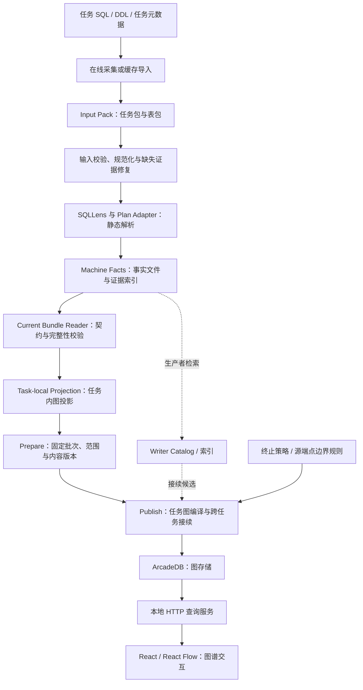
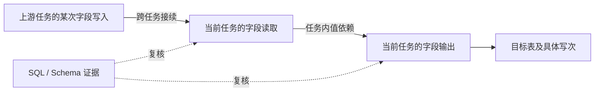

# SQL 静态血缘与数据图谱技术方案

本文说明本仓库的技术路线、处理链路、数据契约、图谱模型、运行入口及验证边界。版本核对结论：**当前事实生成器输出 1.3.0，消费端以 2.0.0 为当前 L1 门槛**。两者尚未在本仓库主入口上对齐，详见第 10 节。

## 1. 解决什么问题

项目从任务 SQL、表结构和采集证据中还原数据加工关系，支持回答：某张表由哪些任务写入、某个字段如何计算、使用了哪些来源和条件、上游能继续追到哪里，以及哪些环节缺少证据。

核心交付是可回到 SQL 和结构快照复核的表级、字段级关系，以及围绕这些关系的查询接口和可视化图谱。图上关系的可信度来自输入证据和解析规则，不能由连线数量、调度顺序或页面展示效果决定。

这里的“采集、清洗、加工”针对 SQL 与元数据：采集任务定义和 DDL，整理输入证据，解析并加工成血缘事实。该链路不执行业务 SQL、不触发调度任务，也不靠读取业务数据行推断来源；图谱发布会写入项目自己的 ArcadeDB 数据库。

## 2. 总体技术路线



采用“事实文件 → 图投影 → 图数据库 → 查询展示”的分层结构。SQL 与结构证据用于复核，Machine Facts 承载解析结果，图数据库承载适合查询的派生关系。修改页面或更换存储，不应改变事实本身；重建图谱也不应回写源系统。

| 技术选择                     | 当前用途                             | 选择理由及约束                                                   |
| ---------------------------- | ------------------------------------ | ---------------------------------------------------------------- |
| Node.js 24+、TypeScript、tsx | 采集编排、事实加工、图构建和后端     | 统一运行环境；使用原生 `fetch`、`node:sqlite` 等能力             |
| SQLLens、项目内 Plan Adapter | SQL 静态解析、关系与表达式证据提取   | 结合方言、DDL 和任务上下文解析；解析失败及不支持的语义需保留缺口 |
| JSON / JSONL、内容哈希       | 输入包、事实包、投影、批次和发布报告 | 文件可检查、可定位、可验证；哈希用于识别内容变化与缓存复用       |
| SQLite 及文件索引            | 生产者检索、证据缓存、元数据目录     | 支撑本地有界查找；不取代源证据                                   |
| ArcadeDB、HTTP API、Cypher   | 图存储、关系更新、图查询             | Node 原生 HTTP 客户端；不依赖 `neo4j-driver`，不走 Bolt          |
| React、React Flow、Vite      | 图谱浏览、表与字段追踪、证据解释     | 前后端分开；前端通过 `/api` 访问后端                             |

实际安装版本以三个 `package-lock.json` 为准，不能用技术栈名称代替兼容性验证。

## 3. 各阶段的输入、处理和输出

| 阶段         | 输入                                    | 主要处理                                                   | 输出及代码入口                                                                                                                                         |
| ------------ | --------------------------------------- | ---------------------------------------------------------- | ------------------------------------------------------------------------------------------------------------------------------------------------------ |
| 采集         | 任务 ID、平台访问权限或本地缓存         | 获取 SQL、任务信息、关联表与 DDL；记录证据来源和采集状态   | Input Pack；[在线批量入口](scripts/input/mainline/collect-task-input-pack.ts)、[缓存导入入口](scripts/input/mainline/collect-input-pack-from-cache.ts) |
| 输入整理     | Task / Table Input Pack、补充证据       | 校验对象身份，规范化分析 SQL，补充缺失结构，修复不完整采集 | 可供分析的 SQL 与 Schema；[输入契约](scripts/input/shared/input-pack.ts)、[分析规范化](scripts/input/shared/sql-analysis-normalization.ts)             |
| 静态解析     | SQL、方言、Schema、任务上下文           | 识别读写、关系、表达式、输出绑定及不确定项                 | Plan Facts 与 Machine Facts；[Plan Adapter](scripts/plans/plan-adapter.ts)、[事实加工入口](scripts/machine-facts/input-pack-machine-facts.ts)          |
| 事实消费校验 | Current Index、状态、Manifest、事实文件 | 验证当前版本、文件完整性、哈希、引用与 SQL 区间            | 带 `CURRENT_L1` 等状态的事实读取结果；[Current Bundle Reader](scripts/query/current-task-bundle.ts)                                                    |
| 任务内投影   | 校验后的事实、任务包与调度背景          | 构建任务内部读写及字段关系，携带证据与覆盖状态             | Task-local Projection；[投影器](scripts/project-graph/task-local/project-task-local.ts)                                                                |
| 批次准备     | 明确的任务范围与投影缓存                | 复用有效缓存、生成批次清单，固定本次待发布内容             | `batch-manifest.json`、`prepared.json`；[Prepare](scripts/project-graph/asset-graph/prepare.ts)                                                        |
| 图谱发布     | Prepared 批次、生产者索引、边界规则     | 编译任务图，判断跨任务接续，按所有者更新图和发布报告       | ArcadeDB 图、版本目录、`current.json`；[Publish](packages/data-graph/src/asset-graph/publish.ts)                                                       |
| 查询展示     | 已发布图与对应版本的证据产物            | 检索、详情、追踪、候选与缺口解释、覆盖统计                 | CLI JSON、HTTP API、React UI；[服务](packages/data-graph/src/asset-graph/service.ts)、[前端](packages/data-graph-ui/src)                               |

### 3.1 采集与证据修复

在线采集器依赖已有 OpenCLI 及平台适配器、登录态和权限。当前实现包含 Horae / szdata 相关采集流程；这些外部环境不会因克隆本仓库自动具备。已有缓存时可以从本地重建 Input Pack，避免重复在线请求。

输入整理应保持原 SQL 与分析 SQL 的可追溯关系。补 DDL、修复 `CREATE TABLE LIKE` 来源、补 SQL 槽位、去除重复采集片段等，目的是提供足够的解析上下文。缺少结构或限定信息时，不能靠同名表、同名字段强行补齐结论。

### 3.2 静态解析与事实加工

SQLLens 与 Plan Adapter 将 SQL 的关系、输出和表达式转换成结构化证据，再由 Machine Facts 加工组织成任务事实包。处理涉及 CTE、子查询、Join、聚合、UNION、窗口、临时对象和多次写入；各类语法的支持程度取决于解析器、适配器及输入完整性，不能承诺任意 SQL 都能闭合。

事实必须回答“在哪个任务、哪个语句或 SQL 槽位、哪次读写、哪个输出位置上得出的关系”，并保留 SQL 快照、哈希、区间和未知项。对不支持的表达式或无法解析的绑定，输出缺口比生成猜测边更有用。

## 4. 数据契约与身份规则

### 4.1 四类产物的职责

| 产物                  | 职责                 | 关键内容                                                                |
| --------------------- | -------------------- | ----------------------------------------------------------------------- |
| Input Pack            | 保存采集输入和来源   | 任务描述、SQL 槽位、表身份、DDL、采集证据                               |
| Machine Facts         | 承载静态解析事实     | 语句、读写观察、关系、字段表达式、输出绑定、临时物化、未知项及 Manifest |
| Task-local Projection | 将事实映射为任务内图 | 节点、边、证据引用、覆盖状态及内容版本                                  |
| Published Graph       | 支撑跨任务图查询     | 任务图、生产消费接续、候选、边界、覆盖统计及发布版本                    |

**实际生成版本与 L1 消费门槛要分别说明。** 当前 `input-pack:machine-facts` 入口输出 `1.3.0`；消费入口将 `2.0.0` 作为当前 L1，将 `1.3.0` 作为遗留事实。存在 2.0.0 的读取判断，不代表生成端已迁移，也不代表当前图谱已使用 2.0.0。状态含义如下：

| 状态            | 含义                               | 使用边界                                                 |
| --------------- | ---------------------------------- | -------------------------------------------------------- |
| `CURRENT_L1`    | 通过当前 L1 契约及读取校验         | 可按当前事实口径消费，仍需逐条满足关系判定条件           |
| `LEGACY_NOT_L1` | 可识别的旧契约                     | 投影证据标为 `PROVISIONAL_LEGACY`，不得自动提升为当前 L1 |
| `STALE`         | 当前索引或版本状态不再对应         | 需更新事实及索引                                         |
| `INVALID`       | 契约、哈希、引用或内容等校验不通过 | 保留失败原因，不作为有效当前事实消费                     |

Reader 通过 Current Index 定位当前任务包，校验状态、Manifest、文件哈希和证据区间；不能通过扫描历史目录挑一个看起来完整的包来替代当前版本。契约的必需文件列表和具体校验以 [Reader 实现](scripts/query/current-task-bundle.ts) 为准。

### 4.2 对象身份与写次身份

物理表身份以 **platform + dataSource + qualifiedName** 为基础。同名表可能属于不同平台或数据源，不能只按最后一段表名合并。字段还必须绑定所属物理表或具体读写上下文。

同一任务可能多次写同一张表。`write_observation_id` 用于标识具体写次，输出字段还要结合语句、绑定和位置确定。不同 SQL 槽位的 ordinal 不能直接拼接；跨任务接续也不能仅凭“目标表相同”选一个写次。

### 4.3 三种状态不能相互替代

- **事实状态**：例如 `CURRENT_L1`，说明事实包是否当前且有效。
- **投影覆盖状态**：例如 `PROJECTED`、`SCHEDULE_ONLY`、`COLLECTION_FAILED`，说明任务材料和投影情况。
- **关系判定状态**：例如 `CONFIRMED`、`CANDIDATE`、`UNKNOWN`，说明某条关系的证据结论。

`PROJECTED` 不等于所有字段都已确认；任务已展示不等于字段闭合；当前有效的事实包也可能包含未知项。

## 5. 图谱模型与跨任务接续

### 5.1 任务内模型

图模型区分任务、物理表、物理字段、读字段、写字段和目标写次等对象。关系分别表达任务读写表、字段值依赖、跨任务接续及候选关系。节点和边携带任务、写次、证据层及状态，供查询和解释使用。

逻辑路径示意如下，具体节点和边类型以投影器及编译器为准：



值来源、Join / Filter 等条件影响需要区分。一个字段参与过滤或关联，并不意味着它的值被写入目标字段。调度上下游仅作为 `scheduleReference` 背景，不能直接生成字段来源结论。

### 5.2 跨任务连接的判定顺序

1. 从当前任务的具体读次定位物理表身份。
2. 使用生产者索引查找已知写观察，区分范围内与范围外任务。
3. 校验写次及字段输出绑定，保留不唯一或未对齐的候选。
4. 比较业务分区，记录 `CONFIRMED`、`ASSUMED`、`UNKNOWN`、`DISJOINT` 等判定。
5. 在证据层、范围、分区及写次条件满足时，生成对应级别的接续；否则保留候选或 gap。

当前接续匹配策略标识为 `business-partitions-first-v3`，实现见 [Continuation](packages/data-graph/src/continuation/continuation-v2.ts)。不能仅凭调度先后、表名相同或时间相邻确认字段接续。

### 5.3 终止策略与源端点边界

项目区分“按规则停止展开”和“证据不足无法继续”。终止策略用于定义表、参数表等对象的追踪边界；源端点规则用于说明采集范围之外的明确来源。命中策略不等于证明该表没有生产者，生产者索引中没有记录也不能证明上游不存在。

发布器会加载两个仓库根目录下的规则文件，它们不随业务配置一起公开：

| 文件                                         | 结构要求                                                                                                    | 作用                     |
| -------------------------------------------- | ----------------------------------------------------------------------------------------------------------- | ------------------------ |
| `config/multi-hop-terminal-table-rules.json` | `version`、非空 `stopRoles`、相应 `roles`；每个角色需要非空 `qualifiedNameTerms`，可附 `qualifiedNameExact` | 按表名规则停止展开       |
| `config/source-endpoint-boundary-rules.json` | `version`、`roles`；每个角色提供非空 `qualifiedNamePrefixes` 或 `consumerTaskCategorySuffixes`              | 对明确源端点保留边界解释 |

规则应由使用方根据真实范围配置，不能直接照搬其他业务的表名前缀。当前加载器使用固定相对位置，单独传入 `--config` 不会替换这两个规则文件的路径。详见 [终止规则加载器](scripts/reconcile/shared/terminal-table-config.ts) 和 [源边界加载器](scripts/reconcile/shared/source-endpoint-boundary-config.ts)。

## 6. 图谱构建、版本与增量更新

`graph:prepare` 接收明确任务范围，读取当前事实并生成或复用任务投影，写出批次 Manifest，再通过临时文件重命名更新 `prepared.json`。准备与发布分开，便于固定本次输入并检查覆盖情况。

`graph:publish` 读取 Prepared 批次，结合编译器版本、匹配策略及规则哈希决定发布版本。相同版本已处于 READY 时可返回未变化；变化任务按 owner 更新派生图，受影响的跨任务接续重新计算。索引和内容哈希用于减少重复解析和无关更新。

数据库记录发布状态 `UPDATING` / `READY`。发布还会生成版本目录中的报告以及文件侧 `current.json`。查询要求图已发布；数据库写入事务、文件指针替换和完整批次发布是不同的边界，不能把整个过程描述成数据库与文件系统之间的单个原子事务。

失败后应先检查图状态、批次版本和发布报告，再决定重跑。发布包含历史产物清理，因此本地运行目录不能当作永久归档，必要证据应另外保留。

## 7. ArcadeDB 接入方案

后端现在使用 [Node 原生 HTTP 客户端](packages/data-graph/src/arcadedb/connection.ts)：通过 ArcadeDB Command API 执行 Cypher，参数以 `params` 传入；多命令写操作通过 begin / commit / rollback 和 session header 维持事务。保留 Cypher 查询语言不代表使用 Neo4j 数据库或 Neo4j 驱动。

连接配置在 `graphDatabase` 中指定 `provider: "arcadedb"`、HTTP(S) 服务地址、数据库名、用户名及密码文件。服务地址应为 HTTP(S) origin，不能使用 `bolt://`。示例见 [workspace.example.json](config/workspace.example.json)。示例用户名只是占位，发布账号实际需要建模、建索引及写入权限。

客户端包含超时、响应错误处理和失败回滚。提交响应丢失时返回 `ARCADEDB_COMMIT_OUTCOME_UNKNOWN`，不能将结果未知当作未提交并盲目重试。密码及本机连接配置由使用方提供，不提交到仓库。

当前 HTTP 测试覆盖客户端行为；实际 ArcadeDB 对现有 Cypher、DDL、索引和事务的兼容性还需要真实实例集成验证。删除驱动依赖不能替代该验证。

## 8. 查询服务与展示

CLI 提供状态、搜索、表字段、详情、追踪、解释及接续候选等查询。HTTP 服务默认监听 `127.0.0.1:8791`，向 UI 提供 `/api/status`、`/api/search`、`/api/fields`、`/api/trace`、`/api/explain` 等接口；此外包含浏览器诊断写入接口。完整路由以 [service.ts](packages/data-graph/src/asset-graph/service.ts) 为准。

React UI 默认运行在 `127.0.0.1:8792`，Vite 将 `/api` 代理到后端。图谱用于检索和展开任务、表、字段关系，并查看相应解释和证据。前端查询应遵守节点、边、跳数和分页限制；截断结果不能描述成完整上游。

当前默认形态是本机使用。仓库没有因此具备面向公网的身份认证、权限隔离和生产运维配置；共享 GitHub 代码与公开部署查询服务是不同的交付。

## 9. 目录与运行入口

| 目录                                          | 保留职责                                     | 使用方式                                      |
| --------------------------------------------- | -------------------------------------------- | --------------------------------------------- |
| `scripts/input`、`scripts/evidence`           | 采集、缓存导入、SQL / DDL 证据整理及输入修复 | 先选在线或缓存主入口，缺材料时再用专项修复    |
| `scripts/plans`、`scripts/machine-facts`      | 静态解析和事实加工                           | 生成事实并检查契约与分析状态                  |
| `scripts/query`、`scripts/reconcile`          | 索引查找、生产者匹配、补充证据与闭合分析     | 为主线提供检索及核验，不必每次执行所有命令    |
| `scripts/project-graph`                       | 任务内投影和批次准备                         | `graph:prepare`                               |
| `packages/data-graph`                         | ArcadeDB 接入、图发布、查询与 HTTP 服务      | `graph:publish`、`graph:query`、`graph:serve` |
| `packages/data-graph-ui`                      | 图谱前端                                     | `graph:ui`、`graph:ui:build`                  |
| `scripts/shared`、`scripts/config`、`schemas` | 共用解析工具、路径配置与契约结构             | 由相应入口调用                                |

脚本数量多主要因为平台采集、输入修复和主线构建各有入口；它们不构成必须顺序执行的总清单。主线只有：**准备输入 → 生成并校验事实 → prepare → publish → query / serve / UI**。`processing-map`、旧专题网页、实验和固定案例审计已排除。

### 9.1 依赖安装与代码检查

三个包分别维护锁文件；根目录的依赖准备脚本只处理根包。首次使用可执行：

```powershell
npm ci
npm --prefix packages/data-graph ci
npm --prefix packages/data-graph-ui ci
npm run typecheck
npm test
npm run build
```

这些命令验证代码和客户端测试，不要求已有业务数据，也不意味着图谱构建已完成。

### 9.2 工作区与外部材料

可复制 `config/workspace.example.json` 为本机 `config/workspace-paths.json`，或在支持的入口传入 `--config`。本机配置被 Git 忽略。

`dataRoot`、`evidenceRoot` 相对于配置文件目录解析；Input Pack、Facts、Projection、Graph 等子路径相对于 `dataRoot` 解析；发布目录再由 profile 的 `batch` 决定。环境变量和显式覆盖另有优先级，详见 [路径解析器](scripts/config/workspace-paths.ts)。

使用方需要提供平台适配器与认证或本地缓存、SQL / DDL 输入、符合当前契约的事实、任务范围文件、两份边界规则，以及实际 ArcadeDB 实例。可选元数据目录用于补充表结构和展示标签，不应改变物理对象身份或血缘判定。

### 9.3 主链路命令

以下为入口调用示意。`example-task`、路径和范围文件需替换；不是空仓库一键演示。**当前事实生成命令产生的是 1.3.0，只能按遗留证据分级；需要 CURRENT_L1 时，应先完成与 2.0.0 门槛的真实对齐，见第 10 节。**

```powershell
# 在线采集：需要已有 OpenCLI、适配器、登录态与平台权限
npm run input-pack:tasks -- --task-ids example-task --data-root .runtime/input-packs

# 或从已有缓存导入；缓存必须符合采集器预期结构
npm run input-pack:from-cache -- --task-ids example-task --data-root .runtime/input-packs --cache-root .runtime/evidence

# 当前事实生成入口：输出 1.3.0，不能作为 CURRENT_L1 验收
npm run input-pack:machine-facts -- --task-id example-task --config config/workspace.example.json

# 准备批次：task-ids.txt 提供本次任务范围
npm run graph:prepare -- --scope task-ids.txt --config config/workspace.example.json

# 发布：需要实际数据库、认证及两份规则文件
npm run graph:publish -- --config config/workspace.example.json
npm run graph:query -- status --config config/workspace.example.json

# 两个终端分别运行查询服务和 UI
npm run graph:serve -- --config config/workspace.example.json
npm run graph:ui
```

生产者索引、表元数据目录和专项修复按材料缺口选择使用。不要为凑齐流程重复执行所有 `input-pack:*`、addon 或 reconcile 命令。

## 10. 当前实现与验证边界

| 项目             | 当前结论                                                                                             | 技术交付时应如何表述                                  |
| ---------------- | ---------------------------------------------------------------------------------------------------- | ----------------------------------------------------- |
| L1 消费门槛      | Reader 要求 `2.0.0` 才归为当前 L1；`1.3.0` 明确归为遗留事实                                          | 区分消费门槛与实际使用版本，不能宣称已完成 2.0.0 迁移 |
| 当前事实生成入口 | `machine-facts-contract.ts` 常量为 `1.3.0`，`machine-facts.ts` 据此写 Manifest；原仓库同一入口也如此 | 当前主入口仍产出 1.3.0；不能仅改版本字符串冒充兼容    |
| 发布规则         | 两份规则文件由发布器必读，本公开仓库未附业务规则                                                     | 接入时需要提供，不能宣称只配数据库即可发布            |
| ArcadeDB 接入    | 已切到 Node 原生 HTTP，移除 Neo4j 驱动依赖                                                           | HTTP 传输层已实现；真实数据库兼容性待集成验证         |
| 代码验证         | 最近代码清理后，TypeScript 检查、7 项 HTTP 客户端测试和前端构建通过                                  | 说明类型、构建及这些测试范围内的行为通过              |
| 完整重建         | 本仓库不附原业务 SQL、数据包、缓存、数据库或完整端到端样本                                           | 不能把当前代码检查结果写成从采集到展示的全链路验收    |

版本差异的直接代码依据：[生成契约常量](scripts/machine-facts/machine-facts-contract.ts)、[Manifest 写入器](scripts/machine-facts/machine-facts.ts)、[当前消费契约](scripts/query/current-task-bundle.ts)、[投影证据分级](scripts/project-graph/task-local/coverage.ts)。当前文档不据此修改代码，也不导入原仓库的业务材料。

真实环境验收应至少验证：2.0.0 事实包由约定生成端产生并通过完整性检查；包含直接映射、计算、条件影响及多次写入的脱敏 SQL 能回到原文复核；跨任务候选不会被自动提升为确认；缺失材料保留 gap；HTTP 发布、查询和失败恢复在实际 ArcadeDB 上成立；UI 展示与发布版本、证据状态一致。

## 11. 对外介绍口径

本项目采用 SQL 静态解析与证据约束的方法，将任务 SQL 和表结构整理成可复核的机器事实，再构建任务内及跨任务的数据血缘图谱。图存储使用 ArcadeDB，通过 Node.js 原生 HTTP 接入；前端使用 React 与 React Flow 展示表、字段、加工关系和证据缺口。

项目价值在于把“表之间可能有关”推进到“能定位具体任务、读写、表达式和依据”，并让未确认的部分保持可见。静态血缘提供结构与加工逻辑依据，生产调度成功、数据质量、实际业务值及业务验收仍需相应运行和业务证据。
